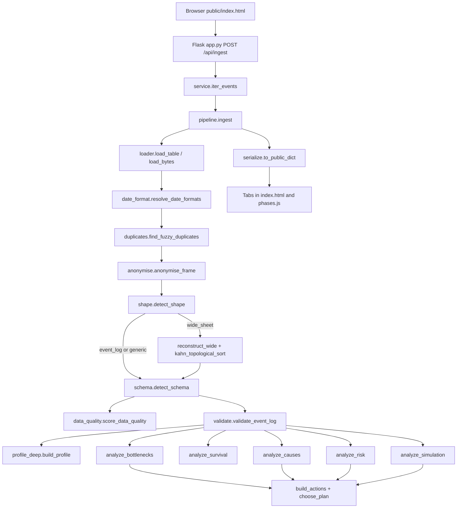

# PRAVAH project report

**Author:** Koushal Acharya  
**Contact:** [linkedin.com/in/koushal-acharya09](https://www.linkedin.com/in/koushal-acharya09) · [github.com/koushalacharya09](https://github.com/koushalacharya09) · [koushalacharya3009@gmail.com](mailto:koushalacharya3009@gmail.com)  
**Code measured:** local tree at `C:\Users\user\PycharmProjects\pravah`  
**How to read this:** every working claim names a file and a function. Numbers come from a command that was run for this report. Features that are not in the tree appear only in Roadmap, marked **Planned**.

`PROJECT_SPEC.md` is not in the repository. The behaviour below is taken from the Python packages, `app.py`, `public/`, `tests/`, `docs/DECISIONS.md`, `docs/THEORY.md`, `docs/INTERVIEW_PREP.md`, `docs/ARCHITECTURE.md`, `pyproject.toml`, `requirements.txt`, and `vercel.json`.

---

## 1. Executive summary

PRAVAH is a Python engine that reads one spreadsheet or event log and answers process questions without calling a language model. A founder uploads a CSV, Excel, or XES file. The engine decides whether the sheet is an event log, a wide sheet of stage dates, or a plain table. Personal columns are hashed before roles are scored. Two scores are returned: data quality on every table, and process readiness only when a case, an activity, and a time exist.

**The problem.** Work sits in ordinary files: enquiry-to-fee on one row per student, or a long list of steps. Mean waiting times and dashboard averages hide unfinished cases, mix correlation with cause, and do not say when the sample is too small.

**Who it is for.** A small coaching or tuition business with a Google Sheet; a lender with a loan file; an operations team with tickets or hiring steps. The built-in samples are a coaching event log, a 24-student wide sheet, a five-row price list, and a 400-case realistic coaching log (`docs/DATA.md`).

**What works today** (run `python -c "from pravah.web.service import analyze_sample; ..."` and `python -m pytest tests --tb=no`):

| Sample | Shape | Data quality | Process readiness | What the later modules said |
| --- | --- | --- | --- | --- |
| `data/sample_event_log.csv` | Event log | 100.0 | 100.0 | 8 cases, 32 events. Bottleneck: attend (share 0.5). Survival: completions between day 0 and day 14. Risk refused (24 finished events, 9 features, need 90). Simulation validated (median 14.05 days). Plan: simulated gain 0.0 days, not selected. |
| `data/sample_wide_sheet.csv` | Wide sheet | 97.5 | 99.7 | 24 cases, 84 events. Stage order enquiry_date → demo_date → joining_date → fee_date. Bottleneck: joining_date (share 0.5021, interval 0.4356 to 0.5693). Risk refused (60 finished events, need 90). Simulation validated (median 89.05 days). |
| `data/sample_generic.csv` | Not a process log | 100.0 | None | 5 rows. Process checks not applied. Survival, risk, causes, and what-if each say they need a case, an activity, and a time. |
| `data/sample_large.csv` | Event log | — | — | 400 cases. Drop-offs, a join bottleneck, demo rework, a tutor time gap, and a planted early-demo effect. See `docs/DATA.md`. |

The page is Flask (`app.py`) plus `public/index.html`. Production URL in `public/index.html` Open Graph tags is `https://pravah-lemon.vercel.app`. Uploads are read from memory (`pravah/web/service.py::analyze_upload`); they are not written to disk (`tests/test_fixes.py::test_upload_is_not_written_with_path_write_bytes`).

What is **not** built: a process map (directly-follows graph), PSI drift monitoring, Bayesian credible intervals, Isolation Forest, clustering, and SQL. Those terms exist in `pravah/glossary.py` so the page can define them; they are not computed.

---

## 2. Why I built this

### Simple

A small business already has the process. It is in a sheet: one row per student with enquiry, demo, joining, and fee dates, or one row per step. The question is where time is lost, who is still open, and whether a change (call within two days, extra seat at a stage) is a cause or only a pattern. Spreadsheet averages treat an open case as finished. Chat-style tools invent a sentence. Process-mining suites assume a clean event log and a specialist.

### Technical

The unit of analysis is the **case**, not the row (`pravah/glossary.py`, term `case`; constant `MIN_CASES_FOR_RATE` in `pravah/ingest/constants.py`). A wide sheet is a set of date columns that must be ordered and melted (`pravah/ingest/reconstruct.py::reconstruct_wide`). An unfinished case is right-censored, not a failure (`pravah/survival/km.py::kaplan_meier`). A treatment effect is an association until balance and four refutations pass (`pravah/causes/refute.py::refute`). A what-if number is blocked unless the simulator reproduces the observed median and stage shares (`pravah/sim/analyze.py::analyze_simulation`, `MEDIAN_TOLERANCE = 0.35`, `SHARE_TOLERANCE = 0.20`).

### Who faces it

- **Small business.** The wide-sheet sample is a coaching admissions file: `student_id`, hashed names and phones, four stage dates, centre, fee. Command: `analyze_sample("wide_sheet")`. Most waiting share sits before `joining_date`.
- **Lender.** The same pipeline accepts a loan file if it has a case, a step, and a time. Schema detection does not require the string `case_id` (`pravah/ingest/schema.py::detect_schema`).
- **MNC operations.** An IT ticket or hiring log is an event log. The sample event log has `student_id`, `step`, `event_time`, hashed `tutor`, `centre` (`data/sample_event_log.csv`).

### Why existing tools fall short for small teams

Excel and BI tools compute means on the rows that are filled. They do not keep open cases in a risk set, do not refuse a model under 10 events per feature (constant `EVENTS_PER_FEATURE = 10` in `pravah/ingest/constants.py`), and do not separate data quality from process readiness (`pravah/ingest/data_quality.py::score_data_quality` vs `pravah/ingest/validate.py::validate_event_log`). AutoML will fit eight students. ChatGPT-style analysis is not a function of the file: this engine never calls an LLM (`app.py` has no such client; `docs/ARCHITECTURE.md` states the page only calls ingest). Celonis and PM4Py expect an event log. PRAVAH rebuilds one from a wide sheet; pm4py is optional and used only to read XES (`pravah/ingest/loader.py::load_table`, optional extra `xes` in `pyproject.toml`).

---

## 3. How PRAVAH is different

### Comparison

| Tool | What it does | What PRAVAH adds (in this tree) | Where the other tool is stronger |
| --- | --- | --- | --- |
| Excel / BI dashboards | Aggregates, charts, filters | Wilson intervals on rates (`pravah/ingest/proportion.py::wilson_interval`); separate quality and readiness; open cases as censoring | Ad-hoc pivot work, joins across many systems, visual design |
| Generic AutoML | Fit many models, pick by accuracy | Time-based split (`pravah/risk/arena.py::_split_cases`); refuse under 10 events per feature; PR-AUC when the rare class is under 40%; prefix leakage test | Large labelled tables, automated feature stores |
| ChatGPT-style analysis | Generated text from a prompt | Numbers come from NumPy/pandas functions; narrative is a template (`pravah/ingest/narrative.py::render_narrative`) | Open-ended questions the engine has no module for |
| Celonis | Enterprise process mining on event logs | Wide-sheet reconstruction; small-n honesty; causal refutations; DES validation gate | Scale, connectors, UI, organisation process repository |
| PM4Py | Python process mining library | pm4py is not the mining engine. Discovery is **Planned**. XES reading may use pm4py if installed | Directly-follows graphs, alignments, inductive miner — not in this tree |

### Core ideas (implemented)

1. **Process reconstruction from wide spreadsheets.** Pairwise `P(A < B)`, Wilson lower bound, Kahn order, melt (`pravah/ingest/reconstruct.py::pairwise_precedence`, `pravah/ingest/topo.py::kahn_topological_sort`).
2. **Small-data honesty.** Worst-case Wald size `n = 1.96² × 0.5 × 0.5 / 0.10² = 97` (constant `MIN_CASES_FOR_RATE` in `pravah/ingest/constants.py`). Headline rates on fewer cases are a preview (`pravah/ingest/validate.py::validate_event_log`).
3. **Correlation versus cause.** IPW and matching run; the verdict is `likely causal` only if SMD < 0.1, the interval excludes 0, and four refutations pass (`pravah/causes/refute.py::refute`).
4. **No AI-generated numbers.** Flask serves the page; analysis is `pravah.ingest.pipeline.ingest`.
5. **Privacy by default.** SHA-256 prefix hash before schema scoring (`pravah/ingest/anonymise.py::hash_value`, `pravah/ingest/anonymise.py::anonymise_frame`). Hashed columns cannot be case, activity, or time (`pravah/ingest/schema.py::detect_schema`). Uploads stay in memory (3 MB cap in `pravah/web/service.py`).

---

## 4. How it works (simple walkthrough)

### Simple path of one upload

1. The browser posts JSON to `POST /api/ingest` (`app.py::ingest_upload`). A sample name or a Base64 file is allowed. The response is NDJSON: one line per pipeline stage, then the result (`pravah/web/service.py::iter_events`).
2. `pravah/ingest/pipeline.py::ingest` loads the bytes, resolves slash dates, finds near-duplicate names, hashes personal columns, scores shape, optionally rebuilds a wide sheet, assigns roles, scores quality and readiness, then lazily imports bottlenecks, survival, risk, causes, simulation, and the plan.
3. `pravah/web/serialize.py::to_public_dict` turns `IngestResult` into JSON. The page (`public/index.html`, `public/phases.js`) draws tabs.

### Worked example: wide sheet

File: `data/sample_wide_sheet.csv`. First header: `student_id,student_name,phone,enquiry_date,demo_date,joining_date,fee_date,centre,fee_amount`. Dates are `DD/MM/YYYY` (example first row `04/03/2010`).

Command used for this report:

```text
python -c "from pravah.web.service import analyze_sample; import json; print(json.dumps({k: analyze_sample('wide_sheet').get(k) for k in ['shape_label','data_quality_score','process_readiness_score','n_cases','n_events','stage_order','anonymised_columns']}))"
```

Observed result: shape **Wide sheet**; data quality **97.5**; process readiness **99.7**; **24 cases, 84 events**; stage order **enquiry_date → demo_date → joining_date → fee_date**; hashed **student_name, phone**.

What that means in order:

1. `resolve_date_formats` treats slash dates as a hypothesis when both parts are ≤ 12 (`pravah/ingest/date_format.py::resolve_date_formats`). Hard evidence (a part > 12) is full confidence (`tests/test_fixes.py::test_hard_day_evidence_is_full_confidence_despite_ambiguous_rows`; `tests/test_deep.py::test_ambiguous_slash_dates_follow_stage_order`).
2. `find_fuzzy_duplicates` reports row numbers for “Rahul Sharma” / “Rahul Sharmaa” without printing the name (`pravah/ingest/duplicates.py::find_fuzzy_duplicates`; `tests/test_deep.py::test_fuzzy_pair_is_reported_without_the_name`).
3. `anonymise_frame` hashes names and phones (`tests/test_pipeline.py::test_wide_sample_rebuilds_a_stage_order_and_keeps_the_swap_visible`).
4. `detect_shape` votes wide (`pravah/ingest/shape.py::detect_shape`; `tests/test_shape.py::test_three_stage_dates_are_a_wide_sheet`).
5. `pairwise_precedence` plus `kahn_topological_sort` produce the four-column order. Health is scored in stage order so a backdated cell stays visible; the working frame is then sorted by time (`pravah/ingest/pipeline.py::ingest`, `_chronological`; `docs/DECISIONS.md`).
6. Later modules run on the melted log. Bottleneck verdict from the same `analyze_sample` call: “Most time is lost before joining_date.” Survival: “Most completions happen between day 88 and day 89.” Risk is refused at 60 finished prefix events versus 90 required.

The generic sample is the negative control: a price list is not forced into a process (`tests/test_pipeline.py::test_generic_sample_is_not_called_a_process`).

---

## 5. System architecture

### Pipeline



Bottleneck, survival, risk, causes, and simulation imports sit **inside** `ingest()`, not at module import, to avoid a circular import through `datetime_parse` (`docs/ARCHITECTURE.md`; `pravah/ingest/pipeline.py::ingest`).

### Folder structure

```text
pravah/                 engine
  ingest/               load, dates, hash, shape, reconstruct, schema, scores
  stats/                Wilson tails, BH, missingness, outliers, relationships, Benford
  perf/                 bottlenecks, Little's Law, resources, trend, rework
  survival/             KM, log-rank, Cox wrapper
  risk/                 prefixes, Markov, arena, Shapley
  causes/               propensity, IPW, matching, refutations
  sim/                  heapq DES, weekly forecast
  plan/                 knapsack, action list
  web/                  Flask helpers
  glossary.py
app.py                  Vercel entry
public/                 index.html, phases.js, about.html, learn.html, og.png, favicon.svg
tests/
data/                   three samples + identifier regression
docs/
vercel.json
pyproject.toml
requirements.txt        subset of runtime pins; pyproject.toml is the full list
```

### What runs where

| Layer | Where | Why |
| --- | --- | --- |
| UI | Static HTML/JS in `public/`, served by Flask | No frontend build. Tabs call the same JSON the tests use. |
| API | `app.py` on Vercel (`vercel.json` functions.app.py) | One Python process; Streamlit needs a long-lived server (`docs/DECISIONS.md`). |
| Engine | `pravah.*` | Deterministic given the file and `RANDOM_SEED = 42` for draws. |
| Tests | `python -m pytest tests` | NetworkX and SciPy only in optional `dev` extras, used as oracles. |

Upload cap: 3 MB (constant `_MAX_BYTES` in `pravah/web/service.py`). Allowed suffixes: `.csv`, `.xlsx`, `.xlsm`, `.xes`.

---

## 6. Code breakdown

Each public algorithm below uses the same headings as `tests/test_docstrings.py` (WHAT / WHY / WHY NOT / ASSUMPTIONS / COMPLEXITY / FAILS WHEN). Helpers without those headings are marked as helpers.

### 6.1 Ingestion

#### `pravah/ingest/loader.py::load_table` / `load_bytes`

**Simple.** Open a CSV, Excel, or XES file as a table.  
**Technical.** pandas `read_csv` / `read_excel`; XES via pm4py if importable, else `_read_xes_builtin`. Blank strings become missing. Duplicate headers are renamed.  
**Why / why not.** Three export formats. pm4py is not used for CSV.  
**Fails when.** Wrong extension, missing sheet, empty XES.  
**Test.** `tests/test_loader.py::test_csv_round_trip_counts`, `test_xlsx_round_trip`, `test_builtin_xes_reader_extracts_the_two_traces`, `test_unknown_extension_is_rejected`.

#### `pravah/ingest/datetime_parse.py::parse_datetimes` and `infer_dayfirst`

**Simple.** Read dates without treating a price as a date.  
**Technical.** Numeric dtypes are not parsed as dates. ISO / year-first skip day-month voting. A part > 12 votes DMY or MDY. Mixed conventions drop ambiguous slash tokens.  
**Why / why not.** Country default would scramble `03/04/2026`. Excel serials in 20,000–60,000 overlap case ids (`docs/DECISIONS.md`).  
**Test.** `tests/test_datetime_parse.py` (ISO, unambiguous DMY/MDY, conflict, integers, parse rate).

#### `pravah/ingest/date_format.py::resolve_date_formats`

**Simple.** One calendar for the sheet when every slash date is ambiguous.  
**Technical.** Parse all date columns both ways. Score mean `P(left < right)` on pairs with ≥ 5 co-parsed rows. Confidence `min(1, |dmy − mdy| / 0.3)`. Gap under 0.05: DMY at confidence 0.35.  
**Why / why not.** `max(P(A<B), P(B<A))` would score a reversed calendar as perfect.  
**Test.** `tests/test_deep.py::test_ambiguous_slash_dates_follow_stage_order`, `test_impossible_day_beats_the_stage_order_guess`.

#### `pravah/ingest/duplicates.py::levenshtein_distance` / `find_fuzzy_duplicates`

**Simple.** Catch “Rahul Sharma” vs “Rahul Sharmaa” before hashing.  
**Technical.** Levenshtein DP. Compare inside a phone block, or same first letter if no phone; skip blocks > 40. Similarity ≥ 0.84. Report row numbers, not names.  
**Why / why not.** All-pairs is quadratic; after hashing, edit distance is gone.  
**Test.** `tests/test_deep.py::test_kitten_to_sitting_takes_three_edits`, `test_fuzzy_pair_is_reported_without_the_name`.

#### `pravah/ingest/anonymise.py::hash_value` / `anonymise_frame`

**Simple.** Replace names, emails, phones, profile URLs with `anon:` plus 16 hex chars.  
**Technical.** `SHA-256(salt|column|value)[:16]`. Default salt `pravah-ingest-v1`. A hashed column cannot win case/activity/time. Resource is allowed.  
**Why / why not.** Dropping the tutor column removes the only resource.  
**Fails when.** Salt is in source; short numbers under 10 digits and a bare first name without a name-like header are kept.  
**Test.** `tests/test_anonymise.py`, `tests/test_fixes.py::test_names_emails_and_profile_urls_are_hashed`, `tests/test_schema.py::test_anonymised_columns_cannot_become_the_case_or_the_activity`.

#### `pravah/ingest/shape.py::detect_shape`

**Simple.** Event log, wide sheet, or plain table.  
**Technical.** Two hand scores. Winner must be ≥ 0.55 (`SHAPE_MIN_CONFIDENCE`). Confidence discounted if scores within 0.20. Exactly two date columns: gap test ±0.15 (`TWO_DATE_GAP_ADJUSTMENT`).  
**Why / why not.** No labelled workbook archive; column-name dictionaries fail on other languages.  
**Test.** `tests/test_shape.py` (classic log, three stages, price list, start+end stays long, two dates + status stay wide).

#### `pravah/ingest/reconstruct.py::pairwise_precedence` / `reconstruct_wide`

**Simple.** Turn date columns into a stage order, then one event per filled cell.  
**Technical.** For columns A, B: `n` co-observed rows, `k` with A strictly before B, `p = k/n`. Keep edge if `n ≥ 5`, `p ≥ 0.75`, Wilson lower bound > 0.5. Melt in topological order.  
**Why / why not.** Mean date moves with one late cell; a blank early stage looks early. A p-value on large `n` keeps 52%.  
**Test.** `tests/test_reconstruct.py` (hand counts, 4/5 vs 5/5, support < 5, emit events).

#### `pravah/ingest/topo.py::kahn_topological_sort` / `resolve_precedence_order`

**Simple.** List stages so every “A before B” is respected. If dates loop, drop the weakest link and say so.  
**Technical.** Remove the left-most in-degree-0 node, one at a time. Cycle: drop lowest probability, then lowest support. `O(V² + E)`.  
**Why / why not.** DFS hides the tie-break. Minimum feedback arc set can delete a strong edge.  
**Test.** `tests/test_topo.py` (diamond, self-loop, NetworkX agrees edges point forward, weakest cycle edge, equal probability drops lower support).

#### `pravah/ingest/schema.py::detect_schema` and `pravah/ingest/schema_scores.py`

**Simple.** Pick case, activity, time, resource by how the column behaves, not by its header.  
**Technical.** Role cutoff 0.45. Ties: left-most column. Case (long log): `repeat * fineness * (1 − nulls) * (0.55 + 0.45 * nunique/max)`. Activity: `0.30 card + 0.30 coverage + 0.25 within + 0.15 reuse`. Timestamp: parse rate × `(0.70 + 0.30 within)`. Resource halved if it never changes inside a case. Wide case: uniqueness × `(1 − 0.5 * name_match_rate)`.  
**Why / why not.** Lowest-cardinality string is often a region.  
**Test.** `tests/test_schema.py::test_roles_follow_structure_not_names`, `test_wide_sheet_picks_the_code_not_the_person_name`.

#### `pravah/ingest/proportion.py::wilson_interval` / `required_n_for_half_width`

**Simple.** A share of 0/5 is not “the rate is zero”.  
**Technical.** Wilson centre and margin with `z = 1.96`, clipped to [0, 1]. Planning `n = z² p (1−p) / E²`. At p=0.5, E=0.10: 97. At p=0.75: 73.  
**Why / why not.** Wald width is 0 when p is 0 or 1.  
**Test.** `tests/test_proportion.py` (hand algebra, 5/5 vs 4/5, 81/100 published bounds, planning 73, scipy quantile rounds to 1.96).

#### `pravah/ingest/data_quality.py::score_data_quality`

**Simple.** Every table: missing cells, duplicate rows, mixed types, outliers.  
**Technical.** Weights 40 / 30 / 30 / 15. A skipped outlier check is dropped and weights renormalised, not charged as a failure.  
**Why / why not.** A missing timestamp is not a dirty price list.  
**Test.** `tests/test_fixes.py::test_clean_plain_table_scores_high_and_skips_process_checks` (quality 100, readiness None).

#### `pravah/ingest/validate.py::validate_event_log` / `combine_quality`

**Simple.** Process readiness: missing roles, unreadable times, backwards pairs, duplicate events, one-event cases.  
**Technical.** Weights 25 / 25 / 20 / 15 / 15. Each component `100 * (1 − bad_fraction)` with a Wilson interval. The headline has no interval (shared rows). Wide health uses stage order before chronological sort.  
**Test.** `tests/test_validate.py::test_quality_score_matches_the_weighted_hand_calculation`, `test_clean_log_scores_one_hundred_and_still_warns_when_small`.

#### `pravah/ingest/readiness.py::readiness_matrix` / `analysis_verdict`

**Simple.** A table of which later analyses this file can support.  
**Technical.** Process map: ≥2 stages or a multi-event log. Bottlenecks: caution under 97 cases. Survival: varied case lengths. Prediction: 10 / 20 events per feature in **cases**. Forecast: 8 weeks floor, 16 comfortable. Causes is Caution “Choose a treatment to unlock.” when case, activity, and time exist, and No otherwise. Band Yes if quality ≥ 80 and sufficient; else Caution / No.  
**Test.** Exercised through `analyze_sample` in `tests/test_polish.py::test_sample_adequacy_uses_cases_and_the_formula_floor`.

#### `pravah/ingest/pipeline.py::ingest` / `pravah/ingest/narrative.py::render_narrative`

**Simple.** Run the chain; fill template sentences with computed values.  
**Technical.** Reporter emits stage ids `read, dates, hash, shape, quality, readiness, bottlenecks, survival, risk, causes, whatif, plan`. Human overrides for roles and `stage_order` (`_apply_role`).  
**Test.** `tests/test_pipeline.py` three samples; `tests/test_web.py` JSON safety.

### 6.2 Statistics helpers

#### `pravah/stats/inference.py::chi2_sf` / `benjamini_hochberg` / `chi_square_independence` / `mann_whitney_p`

**Simple.** A p-value without SciPy in production; many tests get a false-discovery correction.  
**Technical.** Chi-square tail: Wilson–Hilferty cube-root normal. BH: keep through largest k with `p_(k) ≤ (k/m) α`, α=0.05. Chi-square independence withheld if any expected count < 5. Mann–Whitney needs 8 a side.  
**Test.** `tests/test_deep.py::test_benjamini_hochberg_rejects_only_the_small_p_values`, `test_rank_test_separates_two_groups`, `test_chi_square_tail_is_small_for_a_large_statistic`.

#### `pravah/stats/missingness.py::missingness_report`

**Simple.** “12% missing” is not enough: do the blanks line up with another column?  
**Technical.** Flag vs other columns; chi-square or Mann–Whitney; BH. Claim is **not MCAR**, never MAR/MNAR. Runs on the unmelted sheet.  
**Test.** `tests/test_deep.py::test_missingness_flags_a_centre_pattern`.

#### `pravah/stats/outliers.py::modified_z_scores` / `iqr_bounds`

**Simple.** Flag a huge fee without letting it move the yardstick.  
**Technical.** `0.6745 (x − median) / MAD`, flag |z| > 3.5. MAD=0 → 1.5 IQR fence. Need ≥ 8 values.  
**Why / why not.** Ordinary z-score includes the outlier in mean and sd. Isolation Forest is **Planned**, not imported.  
**Test.** `tests/test_deep.py::test_modified_z_ignores_the_mean`.

#### `pravah/stats/relationships.py::spearman` / `cramers_v` / `correlation_ratio` / `mutual_information`

**Simple.** Pick the association that matches the types.  
**Technical.** Spearman = Pearson of midranks. Cramér’s V = `sqrt(χ² / (n min(r−1,c−1)))`. Correlation ratio `sqrt(SS_between / SS_total)`. MI in bits on a histogram. Identifiers excluded; at most 8 columns.  
**Test.** `tests/test_deep.py::test_spearman_sees_a_curve_and_cramers_v_sees_a_split`.

#### `pravah/stats/benford.py::benford_report`

**Simple.** First digits of real amounts prefer 1–3. Skip a three-price list.  
**Technical.** `P(d) = log10(1+1/d)`. Skip if < 30 positives, ≤ 8 distinct, or max/min < 10. Chi-square, 8 df, Wilson–Hilferty tail.  
**Test.** Sample generic skips price/quantity (5 values); asserted via page copy in polish/deep sample runs.

### 6.3 Bottlenecks (`pravah/perf`)

#### `pravah/perf/times.py::find_end_column` / `build_visits`

**Simple.** Build one visit per activity occurrence. If there is a finish column, split wait from work.  
**Technical.** End column: parse rate ≥ 0.8 and ≥ 80% of values at/after the event time; smallest positive median gap; ≥ 5 both-present rows. One timestamp: gap to next event is transition time (wait stored, process null).  
**Test.** `tests/test_bottlenecks.py::test_start_and_end_split_waiting_from_processing`.

#### `pravah/perf/score.py::bootstrap_shares`

**Simple.** Rank steps by the share of total case time spent waiting in front of them.  
**Technical.** `S_a = (Σ_c W_{c,a}) / (Σ_c T_c)`. Resample **cases**, B=1000, seed 42, 2.5/97.5 percentiles.  
**Why / why not.** Mean wait ignores how many cases hit the step. Event bootstrap pretends rows are independent.  
**Test.** `tests/test_bottlenecks.py::test_waiting_share_matches_the_hand_total`, `test_bootstrap_interval_matches_an_independent_resample`. Event log: attend share 0.5 (`test_plain_table_refuses_and_the_event_log_names_attend`).

#### `pravah/perf/littles.py::littles_check`

**Simple.** Check whether a step looks like a stable queue.  
**Technical.** `L = λW` on the completed window. Steady-state flag: relative gap of time-average WIP between the two halves of the window > 0.25. Need ≥ 5 completed visits. Full-window `λW` equals time-average WIP when every arrival departs in the window, so that identity is not the flag.  
**Test.** `tests/test_bottlenecks.py::test_steady_queue_passes_littles_law_and_a_growing_wait_does_not`.

#### `pravah/perf/resources.py::shrink_resources`

**Simple.** A tutor with one slow case cannot top the list.  
**Technical.** `n/(n+5) * m + 5/(n+5) * m_all`. Rank cap: n<5 cannot outrank n≥5.  
**Test.** `tests/test_bottlenecks.py::test_a_single_slow_event_cannot_outrank_a_larger_resource`; event log top resource is not the raw “Meera” name (hashed).

#### `pravah/perf/trend.py::slowdown_index` / `weekly_trend`

**Simple.** Name one Monday after which weekly median throughput got slower.  
**Technical.** Binary segmentation, min 2 weeks each side, later mean higher, RSS drop ≥ 20%.  
**Test.** `tests/test_bottlenecks.py::test_binary_segmentation_names_the_slower_week`.

#### `pravah/perf/rework.py::rework_table`

**Simple.** Extra days from the first time a step repeats to the last.  
**Technical.** Span last − first occurrence, not whole throughput.  
**Test.** `tests/test_bottlenecks.py::test_rework_extra_days_are_the_span_from_first_to_last_repeat`.

### 6.4 Survival (`pravah/survival`)

#### `pravah/survival/events.py::prepare_cases`

**Simple.** One duration per case. Completion = first time the chosen activity appears. Dropout = silence longer than a threshold before the file’s last timestamp. Reaching completion censors dropout. Study end is the file clock, not the server clock. Default completion: modal last activity. Default silence: 14 days. Segments: resource plus columns with 2–6 levels, not case/activity/time, max 4.  
**Test.** `tests/test_survival.py::test_completion_censors_cases_that_never_arrive_and_dropout_uses_the_threshold`.

#### `pravah/survival/km.py::kaplan_meier` / `window_sentence`

**Simple.** Keep open cases on the curve. Name the day range with the highest drop (or completion).  
**Technical.** Product-limit: `S ← S (1 − d/n)`. Greenwood sum `d/(n(n−d))`. 95% band: log-log, z=1.96. Hazard window: max d/n from previous event time to that time. Sentence: “Most drop-offs happen between day X and day Y” or completions.  
**Why / why not.** `S ± 1.96 se` leaves [0,1].  
**Test.** `tests/test_survival.py::test_greenwood_matches_the_hand_product_and_lifelines`, `test_an_open_case_is_not_counted_as_a_failure`. Event log: censored==0, completion `attend`.

#### `pravah/survival/logrank.py::logrank` / `compare_segments`

**Simple.** Do two groups’ curves differ? If many groups, correct the p-values.  
**Technical.** Mantel–Haenszel two-group vs largest level; skip n<3. BH if more than one comparison.  
**Test.** `tests/test_survival.py::test_logrank_statistic_matches_lifelines`, `test_many_segments_use_benjamini_hochberg_and_a_crossed_hazard_is_refused`.

#### `pravah/survival/cox.py::fit_cox`

**Simple.** One hazard ratio only if the gap does not change direction over time.  
**Technical.** `lifelines.CoxPHFitter` + `proportional_hazard_test` rank transform. Need ≥ 8 events. If any Schoenfeld p<0.05, ratios withheld; sentence points to stratified KM.  
**Why / why not.** From-scratch partial likelihood was rejected; the claim is the check.  
**Test.** `tests/test_survival.py::test_many_segments_use_benjamini_hochberg_and_a_crossed_hazard_is_refused`.

### 6.5 Risk (`pravah/risk`)

#### `pravah/risk/prefix.py::features_at` / `build_prefixes`

**Simple.** A training row may only use facts already on the clock.  
**Technical.** Features: time since start, events so far, time since last, rework count, resource load (events of that resource with timestamp ≤ prefix), day of week, last activity. Prefixs stop before completion. Label stored separately.  
**Test.** `tests/test_later_phases.py::test_a_prefix_cannot_see_a_later_event` (second step named `secret` never appears).

#### `pravah/risk/markov.py::transition_counts` / `absorption_probabilities`

**Simple.** From this step, chance of eventually completing vs dropping.  
**Technical.** Absorbing states `complete` and `drop`. `(I − Q)^{-1} R` via `numpy.linalg.solve`.  
**Test.** `tests/test_later_phases.py::test_absorption_follows_a_certain_path` (A→B→complete gives complete=1).

#### `pravah/risk/arena.py::run_arena`

**Simple.** Compare a naive rate, logistic regression, random forest, boosting. Pick fairly.  
**Technical.** Cases ordered by start: 60% train, 20% calibrate, 20% test. SLA = training 75th percentile of duration. Classification: drop or duration > SLA. Imbalanced if minority < 0.4 → pick PR-AUC, else ROC-AUC. Reliability gap > 0.10 → isotonic on calibration slice. Regression MAE vs mean baseline. Forests: 40 trees, depth 3, `random_state=42`.  
**Why / why not.** Accuracy on rare dropouts is a trap. Random split leaks future weeks.  
**Test.** `tests/test_later_phases.py::test_conformal_interval_names_its_coverage`; event log refusal `test_event_log_refuses_to_train`.

#### `pravah/risk/arena.py::_conformal`

**Simple.** A remaining-time interval with a stated 90% target, checked on later cases.  
**Technical.** Split conformal: quantile `ceil((n_cal+1)*0.9)/n_cal` of absolute calibration residuals.  
**Test.** Same conformal test: `target == 0.9` and empirical coverage ≥ 0.7 on that synthetic frame.

#### `pravah/risk/shapley.py::exact_shapley` and `arena._importance`

**Simple.** Global: which column moves the score when shuffled. Local: top 3 facts for this open case.  
**Technical.** Exact Shapley vs training-mean background, 2^p, p≤12. Linear check: `shapley_i = w_i (x_i − mean_i)`. Permutation importance: Brier increase. Glossary key `SHAP value`. No `shap` package.  
**Test.** `tests/test_later_phases.py::test_shapley_matches_a_linear_model`.

#### `pravah/risk/analyze.py::analyze_risk`

**Simple.** If too few finished prefixes, refuse. Otherwise list open cases by probability.  
**Technical.** Need `EVENTS_PER_FEATURE * n_features` finished prefix rows. Event log: 24 finished events, 9 features, need 90.  
**Test.** `tests/test_later_phases.py::test_event_log_refuses_to_train`.

### 6.6 Causes (`pravah/causes`)

#### `pravah/causes/analyze.py::candidate_treatments` / `build_table` / `analyze_causes`

**Simple.** Treatments come from activities in the file (reached X within the median time), not a hardcoded “demo”. Outcomes: reached an activity. Confounders: checkboxes on columns.  
**Technical.** Untreated = never reached the activity. No estimate until the user picks both.  
**Test.** Candidates appear on event-log JSON (`analyze_sample("event_log")["causes"]["verdict"]` starts with pick a treatment). Effect recovery is synthetic (below).

#### `pravah/causes/effect.py::standardised_mean_difference` / `fit_effect`

**Simple.** Compare treated vs not, after making the groups look alike.  
**Technical.** Logistic propensity. Trim scores outside [0.05, 0.95]. Stabilised IPW: `p/e` treated, `(1-p)/(1-e)` control. Matching: 1:1 NN on logit, caliper 0.2 sd, no reuse. Bootstrap rows, default 300 draws (pipeline uses 120), seed 42. SMD after weights must be < 0.1 to count as balanced. Need both groups and ≥ 20 rows; trim must leave ≥ 8 a side.  
**Why / why not.** Outcome~treatment only is the association. Doubly robust needs a second outcome model not justified here.  
**Test.** `tests/test_later_phases.py::test_known_treatment_effect_is_recovered` (n=500, |IPW − true risk difference| < 0.12, interval contains the estimate, all SMD balanced).

#### `pravah/causes/refute.py::e_value` / `refute`

**Simple.** Four ways the claim should break if it is luck.  
**Technical.** Placebo: shuffle treatment, CI must cover 0. Random N(0,1) column: sign kept, CI still excludes 0. 75% subset: same sign. E-value `RR + sqrt(RR(RR−1))` ≥ 1.2 and original CI excludes 0. Verdict `likely causal` only if all pass **and** balance. Else `association only` plus the failed check.  
**Test.** Synthetic path goes through `fit_effect`; verdict rule is in `refute` and is the product of those booleans (no separate “always causal” shortcut in code).

### 6.7 Simulation (`pravah/sim`)

#### `pravah/sim/engine.py::run_replication`

**Simple.** Replay cases with a clock that jumps to the next event.  
**Technical.** `heapq` of arrivals and finishes. Inter-arrivals and service times: `rng.choice` of empirical lists. Routing: Markov row. Capacity per activity. Scenarios: capacity, `wait_scale`, `skip`, `volume`. Cap 16 steps per case. Seed supplied by caller (`42+i` baseline, `100+i` scenario).  
**Why / why not.** Jackson network needs exponential service; the file’s times are not assumed exponential.  
**Test.** Indirectly via `analyze_simulation` validation test.

#### `pravah/sim/forecast.py::weekly_counts` / `seasonal_forecast`

**Simple.** Next weeks of arrivals, compared with “same as four weeks ago”.  
**Technical.** Period 4. Seasonal naive: y_{t−4}. Decomposition: rolling mean + average leftover by cycle position. Ship decomposition only if holdout MAE is lower. < 8 weeks: mean, and say so.  
**Test.** Event log covers 2 weeks: sentence “Only 2 weeks. Seasonal decomposition needs 8…” (from `analyze_sample("event_log")["simulation"]["forecast"]`).

#### `pravah/sim/analyze.py::analyze_simulation`

**Simple.** If the replay cannot match this file, do not invent a saving.  
**Technical.** Baseline capacity 32 servers per activity. 8 baseline replications. Valid if relative median error ≤ 0.35 and max |stage-share error| ≤ 0.20. Then 16 scenario replications; 5th/95th = 90% interval across seeds.  
**Test.** `tests/test_later_phases.py::test_two_step_log_validates_before_a_scenario`. Event log: relative error 0.0036, share error 0.

### 6.8 Action plan (`pravah/plan`)

#### `pravah/plan/analyze.py::build_actions` / `choose_plan`

**Simple.** Actions only from earlier modules. Cost is typed by the user. No gain if simulation did not validate a difference.  
**Technical.** Sources: top bottleneck activity, `likely causal` only, highest-risk open case, first rework loop. Gain = baseline median − scenario median. Null or ≤ 0 gain is not costed. PDF lines are these sentences (`public/index.html` `downloadReport` appends `plan.lines`).  
**Test.** Event log line: “Add capacity before attend. The simulated gain is 0.0 days, so it is not selected.”

#### `pravah/plan/knapsack.py::knapsack`

**Simple.** Best subset under an integer budget, not “best ratio first”.  
**Technical.** DP `best[c]`, each item once, budget downward. Greedy by value/cost computed beside it.  
**Test.** `tests/test_later_phases.py::test_knapsack_beats_the_greedy_ratio`: values 60,100,120 costs 10,20,30 budget 50 → DP 220, greedy 160.

### 6.9 Web and page

#### `app.py::ingest_upload`

Touches the first NDJSON line before `Response` so a bad body is still HTTP 400.

#### `pravah/web/service.py::analyze_sample` / `analyze_upload` / `iter_events`

Tests call `analyze_sample` / `analyze_upload` (dicts). The page uses `iter_events`. Upload never `Path.write_bytes` (`tests/test_fixes.py::test_upload_is_not_written_with_path_write_bytes`).

#### `public/index.html` + `public/phases.js`

Tabs: Overview, Data Quality, Readiness, Bottlenecks, Survival, Risk, Causes, What-if, Action plan, Dates & Privacy, Raw Data. Roadmap marks process map **building**; survival/risk/causes/what-if/plan **live**. Footer: Designed & built by Koushal Acharya; Let’s connect with Koushal; LinkedIn / mailto / GitHub icons; trust line only. Tour: `localStorage` key `pravah-tour`. Theme: `pravah-theme`. Reduced motion: `prefers-reduced-motion`.

**Test.** `tests/test_polish.py::test_page_shell_has_product_basics`, `test_about_and_favicon_are_served`; `tests/test_glossary.py` page+learn+sample JSON unglossed check.

---

## 7. Data science concepts used

| Concept | Status | Where |
| --- | --- | --- |
| Python, Pandas, NumPy | Used | whole engine |
| Data cleaning / validation | Used | loader, validate, data_quality |
| EDA (missingness, relationships, Benford, outliers) | Used | stats/*, profile_deep |
| Statistics / probability | Used | proportion, inference |
| Confidence interval (Wilson) | Used | wilson_interval |
| Credible interval | **Planned** | glossary only |
| Sample size formula | Used | MIN_CASES_FOR_RATE, PRECEDENCE_ROWS_FOR_PM10 |
| Hypothesis tests | Used | chi-square, Mann–Whitney, log-rank, Schoenfeld |
| Benjamini–Hochberg | Used | missingness, log-rank segments |
| MAD / modified z | Used | outliers.modified_z_scores |
| MCAR tests | Used | missingness_report (not MCAR only) |
| Spearman, Cramér’s V, correlation ratio, MI | Used | relationships.py |
| Benford’s Law | Used | benford.py |
| Entity resolution | Used | duplicates (Levenshtein blocks) |
| Graph theory / topological sort | Used | topo.py |
| Edit distance | Used | levenshtein_distance |
| Clustering | **Planned** | not imported |
| Markov chains | Used | risk/markov.py, sim routing |
| Survival analysis | Used | survival/* |
| Classification / regression | Used | risk/arena.py (sklearn) |
| Model evaluation (ROC-AUC, PR-AUC, Brier, MAE) | Used | arena.py |
| Calibration | Used | reliability + IsotonicRegression |
| Conformal prediction | Used | _conformal |
| SHAP (exact Shapley) | Used | shapley.py from scratch |
| Permutation importance | Used | arena._importance |
| Causal inference (propensity, IPW, matching, refutation, E-value) | Used | causes/* |
| Anomaly detection (Isolation Forest) | **Planned** | modified z only |
| Time series (seasonal naive vs decomposition) | Used | sim/forecast.py |
| Discrete-event simulation | Used | sim/engine.py |
| Knapsack optimisation | Used | plan/knapsack.py |
| SQL | **Planned** | no database |
| Monitoring (PSI) | **Planned** | glossary only |
| Privacy hashing | Used | anonymise.py |

For each **Used** concept: simple meaning is the glossary `plain` field; technical meaning is `technical`; why/why not is the matching DECISIONS/THEORY paragraph already cited in section 6. **Planned** items are defined in `pravah/glossary.py` so a future sentence can be underlined, and are not computed anywhere in `pravah/`.

**Clustering, SQL, Isolation Forest, PSI, credible intervals** have no function in `pravah/`. A search of `*.py` for `IsolationForest`, `sqlalchemy`, `PSI` computation, and cluster estimators returned no engine hits (PSI appears only as a glossary key and in `tests/test_glossary.py` REQUIRED list).

**Variant** and **directly-follows graph** are glossary terms. No DFG is built. Rework is a repeated activity inside a case (`rework_table`), not a cycle in a graph.

---

## 8. Technology and libraries

Versions from this machine (`import X; X.__version__` / `importlib.metadata.version`).

| Name | Version seen | Role | Why chosen | Considered instead | Scratch vs library |
| --- | --- | --- | --- | --- | --- |
| Python | 3.14.5 local; `requires-python >= 3.11`; Vercel Python 3.12 default | Runtime | Matches pyproject | Pinning 3.12 in `.python-version` was avoided so local 3.14 still runs | — |
| pandas | 2.3.3 (`>=2.2`) | Tables, groupby, datetime | Event log is a DataFrame | Polars (no existing tests) | Library for I/O; algorithms are explicit loops/NumPy |
| numpy | 2.5.2 (`>=1.26`) | Arrays, linalg.solve, quantiles, Generator(42) | KM, IPW, DES, Shapley | Pure Python lists | Scratch math on ndarray |
| Flask | 3.1.3 (`>=3.0`) | HTTP | Vercel detects `app` | Streamlit (no long-lived server); static JS-only (engine is Python) | Library |
| openpyxl | 3.1.5 (`>=3.1`) | xlsx | pandas Excel | xlrd (xlsx unsupported) | Library |
| scikit-learn | 1.9.1 (`>=1.4`) | Logistic, RF, GBM, Dummy/prior, Isotonic, LinearRegression | Arena and propensity | Writing SGD from scratch | Fit/predict from sklearn; split/metrics wiring from scratch |
| lifelines | 0.30.3 (`>=0.29`) | CoxPHFitter, PH test, KM/log-rank **oracle in tests** | Spec allows lifelines for Cox | From-scratch Cox | KM and log-rank in-tree; Cox from lifelines |
| pytest | 9.1.1 (dev extra) | Tests | Standard | unittest | — |
| networkx | 3.7 (dev) | Test oracle for topo | Not a runtime dep | Using NX in core would hide Kahn | Core scratch |
| scipy | 1.18.1 (dev) | Test oracle for 1.96 quantile | Not a runtime dep | SciPy chi2 in core rejected for install size / Wilson–Hilferty already used | Core scratch |
| pm4py | optional extra `xes` | XES read only | Spec | Reimplement all XES | Discovery **Planned** |
| shap | not in pyproject | — | Exact Shapley instead | TreeSHAP | Scratch `exact_shapley` |
| fpdf2 | installed for this report | PDF of this document | Helvetica, no extra runtime dep for the app | WeasyPrint (system cairo) | Report only |

`requirements.txt` pins every runtime dependency from `pyproject.toml`, including flask, numpy, pandas, openpyxl, lifelines, and scikit-learn. Frontend: no npm package.json; Lucide-style inline SVG in HTML.

Vercel: `vercel.json` rewrites `/about` → `/about.html`, `/learn` → `/learn.html`; excludes tests/docs/venv from the function bundle.

---

## 9. Engineering decisions

Pulled from `docs/DECISIONS.md` and the code that implements them.

**Testing.** Unit tests with hand numbers (Wilson 5/5 vs 4/5, KM product-limit, bottleneck 5/9 and 4/9, knapsack 220 vs 160). Library oracles: lifelines KM/log-rank, NetworkX edge direction, SciPy 0.975 quantile. Leakage test on prefixes. Synthetic DGP for IPW. Docstring heading test. Glossary watch-list. Upload not written to disk. Command: `python -m pytest tests --tb=no`.

**Leakage.** Prefixes exclude the completion event. SLA percentile is training-fold only (`run_arena`). Time split by case start, not random rows. Resource load uses timestamps ≤ prefix, including other cases’ past.

**Reproducibility.** `RANDOM_SEED = 42` in `pravah/ingest/constants.py`. Ingestion draws no random numbers. Bootstrap, sklearn `random_state`, IPW bootstrap, DES replications, permutation importance, and refutation noise all thread that seed.

**Privacy.** Hash before schema. Anonymised columns blocked from case/activity/time. Fuzzy duplicates report indices. 3 MB cap. In-memory BytesIO. Share link only for named samples (`public/index.html` `copyLink`).

**Performance.** Vercel cold start loads pandas. DES 16 replications, Cox on small n may warn (ill-conditioned Hessian on the 8-case log). Exact Shapley capped at 12 features / 12 open cases explained. Refutation bootstraps 40 draws each.

**Deployment.** Flask on Vercel, not Streamlit. Public files at `/about.html`, `/og.png`, `/favicon.svg`, `/phases.js`. NDJSON may be buffered by the platform; the engine still emits one line per finished stage with no artificial sleep.

**Human override.** Dropdowns re-post `overrides` and `survival` / `modules` (`public/index.html` `currentOverrides`, `moduleSettings`). `rendering` flag avoids a select-populate loop.

---

## 10. Results and validation

### Test suite

```text
python -m pytest tests --tb=no
```

The suite is `python -m pytest tests`. Cox is skipped below `MIN_COX_EVENTS` (40 observed events). Pandas timedeltas use an explicit unit.

From-scratch vs library:

| Claim | Scratch function | Oracle | Test |
| --- | --- | --- | --- |
| KM survival and log-log band | `kaplan_meier` | `lifelines.KaplanMeierFitter` | `test_greenwood_matches_the_hand_product_and_lifelines` |
| Log-rank statistic | `logrank` | `lifelines.statistics.logrank_test` | `test_logrank_statistic_matches_lifelines` |
| Topological edges point forward | `kahn_topological_sort` | networkx | `test_networkx_agrees_that_every_edge_points_forward` |
| z = 1.96 | `Z_95` | scipy.stats.norm.ppf(0.975) | `test_scipy_norm_quantile_rounds_to_the_constant_we_use` |
| Shapley on a linear score | `exact_shapley` | closed form w(x−mean) | `test_shapley_matches_a_linear_model` |

### Demo datasets (same `analyze_sample` dump as section 1)

**Event log.** 8 cases / 32 events. Hashed student_name, phone, tutor. Bottleneck attend 50% of throughput (CI 0.5–0.5 because cases are identical in gap structure). Survival: all complete at attend. Markov: 100% absorb in complete from every step. Simulation relative error 0.0036 vs 14-day observed median. Plan gain 0.

**Wide sheet.** 24 cases / 84 events. Quality 97.5 (not 100: the sheet has a backdated / swapped cell kept visible). Readiness 99.7. Order enquiry → demo → joining → fee. joining_date share 0.5021 (bootstrap 0.4356–0.5693), median wait 46 days. Survival window days 88–89. Risk still under 90 prefix events.

**Generic.** Quality 100, readiness None, 5 rows, process modules refuse.

These numbers are previews: 8 and 24 are below 97 cases.

---

## 11. Limitations (honest)

**Technical.** 3 MB upload. Serverless timeout and cold start. Heuristic shape/schema can mis-label a two-date status sheet without the gap test, and a one-activity-per-case catalogue has low coverage. Builtin XES keeps one attribute level. DES with empirical self-loops is capped at 16 steps. Cox on 8 cases does not converge (event log). Exact Shapley is exponential in features.

**Statistical.** Wilson treats rows as independent; several events per case make intervals too narrow (stated in THEORY). Missingness independence also treats rows as independent. Unmeasured confounding: E-value is a sensitivity number, not a proof. PH test can fail by noise on small n. Conformal coverage is guaranteed under exchangeability of residuals; a time split is the production analogue, not a proof of i.i.d. Seasonal decomposition on < 8 weeks is not scored. Simulation 90% interval is across random seeds, not a CI for a population mean. Knapsack values are simulated days, not money, unless the user interprets them that way.

**Product.** No process map / DFG / variants chart. No PSI monitoring. No Bayesian credible intervals. No Isolation Forest. No SQL warehouse. The readiness matrix says “Choose a treatment to unlock.” when the three roles exist. A sheet with at least 97 cases estimates a default treatment on first load. Process map remains tagged building on the homepage.

---

## 12. Benefits

**Small business (coaching).** On the wide sample, most waiting share is before `joining_date` (50.21%, interval 43.6%–56.9%). A founder can ask whether to add joining capacity rather than a generic “speed everything up”. Risk will not fake an AUC on 24 students.

**Bank or lender.** The same refusal rule blocks a default model on a small loan book (`EVENTS_PER_FEATURE`). Survival keeps open applications in the curve instead of dropping them. A treatment such as “reached underwriting within the median time” is generated from activities, not a hardcoded product name.

**MNC (tickets / hiring).** Bottleneck share answers which queue eats calendar time. Little’s Law says whether that queue is in steady state. What-if is blocked if the replay does not match observed median and stage shares. The plan cannot recommend an action whose simulator produced no shortening.

These are decision supports from computed fields, not guarantees of lift. The samples are below the 97-case floor.

---

## 13. Roadmap

| Item | Status |
| --- | --- |
| Ingestion, quality, readiness, dates, privacy | Live (`ingest`, scores, UI) |
| Bottlenecks, Little's Law, resources, trend, rework | Live (`pravah/perf`) |
| Survival KM, log-rank, Cox check | Live (`pravah/survival`) |
| Risk prefixes, Markov, arena, conformal, Shapley | Live (`pravah/risk`); training refused on both samples |
| Causes IPW / matching / refutation | Live (`pravah/causes`); auto-picks a treatment at 97+ cases |
| What-if DES + forecast | Live (`pravah/sim`) |
| Action plan knapsack + PDF lines | Live (`pravah/plan`) |
| Process map / DFG / variants / process replay animation | **Planned** |
| PSI / drift monitoring | **Planned** (glossary only) |
| Credible intervals | **Planned** (glossary only) |
| Isolation Forest / clustering | **Planned** |
| SQL / warehouse connectors | **Planned** |
| Time-varying Cox if PH fails | **Planned** (today: stratified KM) |
| Doubly robust causal estimator | **Planned** (explicitly rejected for now) |

Future ideas not in code: multi-file joins, user accounts, stored uploads (rejected: privacy), LLM narratives (rejected: numbers must be computed).

---

## 14. Interview Q&A

Answers are what the code does. Forty questions.

1. **Why Kahn, not DFS or a heap?** `kahn_topological_sort` removes the left-most in-degree-0 node. DFS hides the tie-break. A heap is the same rule with log V; V is a handful of date columns. Test: `tests/test_topo.py`.
2. **Why drop the weakest cycle edge, not the minimum feedback arc set?** MFAS can delete a strong edge. The rule is lowest p then lowest support, and the drop is reported (`resolve_precedence_order`).
3. **Why 75% and a Wilson bound, not a p-value?** 52% is significant on a large n. 4/5 has p̂=0.8 and Wilson lower bound ~0.38, so no edge. 5/5 lower bound ~0.57. Test: `test_four_of_five_does_not_become_an_edge_and_five_of_five_does`.
4. **Why not mean date for stage order?** One late cell moves it; blank early stages never enter the mean (`pairwise_precedence`).
5. **Why is 97 the sample floor?** `ceil(1.96² × 0.25 / 0.10²) = 97` (`MIN_CASES_FOR_RATE`). Test: `test_sample_adequacy_uses_cases_and_the_formula_floor`.
6. **Why two scores?** Quality applies to every table; readiness only with case+activity+time (`score_data_quality` vs `validate_event_log`).
7. **Why no CI on the headline score?** Five rates share rows; summing Wilson variances is too tight. Each rate has its own interval.
8. **Why is `03/04/2026` a hypothesis?** Both calendars legal until a part > 12 or sheet-level order consistency (`resolve_date_formats`).
9. **Why not a z-score?** Mean and sd chase the outlier. Modified z uses median and MAD (`modified_z_scores`).
10. **Why is 12% missing not enough?** Test the missing flag vs other columns; BH at 0.05; claim not MCAR only (`missingness_report`).
11. **Why Spearman / V / eta / MI?** Types differ; Pearson on categories invents an order (`relationship_matrix`).
12. **Why skip Benford on a price list?** Need 30 positives, >8 distinct, range ×10 (`benford_report`).
13. **Why hash before schema?** A name would otherwise win the case role (`anonymise_frame` then `detect_schema`).
14. **Why can a hashed column be the resource?** Tutors must remain groupable (`detect_schema` docstring).
15. **Why not store uploads?** Privacy; `analyze_upload` uses bytes; test monkeypatches `write_bytes`.
16. **Why Flask on Vercel, not Streamlit?** Streamlit needs a persistent server (`docs/DECISIONS.md`).
17. **Why lazy-import perf/survival inside `ingest`?** Circular import via `datetime_parse` and package `__init__`.
18. **Why bottleneck share, not mean wait?** Rare long waits are not where the organisation loses days (`bootstrap_shares`).
19. **Why resample cases, not rows?** Events in a case are not a sample (`bootstrap_shares`, seed 42, B=1000).
20. **Why Little's halves?** Full-window λW equals WIP if every job completes; it cannot see a filling queue (`littles_check`).
21. **Why shrink resources with n0=5?** One slow case would top the list; estimating prior variance from groups lets it escape (`shrink_resources`).
22. **Why one slowdown date?** The question is one Monday; CUSUM needs a se threshold four weeks cannot estimate (`slowdown_index`).
23. **Why censor open cases?** Dropping them makes the process look faster; calling last day a failure makes it look slower (`kaplan_meier`).
24. **Why log-log Greenwood, not S±1.96 se?** The linear band leaves [0,1]; log-log matches lifelines.
25. **Why withhold Cox when PH fails?** A crossed hazard has no single ratio (`fit_cox`).
26. **Why BH on log-rank?** Many segment levels; uncorrected 0.05 invents a difference (`compare_segments`).
27. **How do you prevent leakage?** Prefixes stop before the outcome; leakage test uses activity name `secret` (`build_prefixes`).
28. **Why refuse the event-log model?** 24 finished events, 9 features, need 90 (`analyze_risk`).
29. **Why PR-AUC?** Rare class < 40%: ROC can look healthy while dropouts are missed (`run_arena`).
30. **Why exact Shapley, not the shap package?** p is small; definition is the 2^p sum (`exact_shapley`).
31. **What does 90% conformal claim?** Coverage under residual exchangeability, checked on the last time block (`_conformal`). Not a coefficient CI.
32. **How do you know this is causal?** You do not, unless balance SMD<0.1, CI excludes 0, and placebo, random cause, subset, and E-value ≥ 1.2 all pass (`refute`). Otherwise association only.
33. **Why generate treatments from activities?** A hospital log has no “demo” (`candidate_treatments`).
34. **Why trim propensity to 0.05–0.95?** Scores at 0 or 1 mean no overlap (`fit_effect`).
35. **Why two estimators (IPW and matching)?** They share a propensity model, not a formula (`fit_effect`).
36. **Why can what-if be refused?** Baseline must match median within 35% and shares within 0.20 (`analyze_simulation`).
37. **Is the 90% sim interval a confidence interval?** No. It is the 5th–95th percentile across 16 seeds.
38. **When does seasonal decomposition drive arrivals?** Only if its MAE beats seasonal naive; else say so (`seasonal_forecast`).
39. **Why knapsack, not greedy?** 60+100=160 vs 100+120=220 at budget 50 (`knapsack`).
40. **Where do plan sentences come from?** Copied fields from bottlenecks/causes/risk/rework plus a simulated interval (`build_actions`, `choose_plan`). No sentence without that source.
41. **What if the data is small?** Preview tag; rates still shown with Wilson; models refuse; causal needs ≥20 rows and overlap.
42. **Why seed 42 everywhere draws happen?** One constant so published intervals repeat (`RANDOM_SEED`).
43. **Why not NetworkX in production?** Kahn is the explainable algorithm; NX is a test oracle.
44. **Why Wilson–Hilferty instead of scipy.chi2?** No SciPy runtime dependency (`chi2_sf`).
45. **What happens if IQR and MAD both fail?** Fewer than 8 numbers are not scored (`modified_z_scores`).
46. **Can the founder override roles?** Yes, `overrides` in the POST body (`_apply_role`).
47. **Does the PDF include the action plan?** `downloadReport` appends `payload.plan.lines` after the quality summary.
48. **Is the process map live?** No. Readiness may say steps can be read; the DFG UI is Planned.
49. **Why 3 MB?** Under typical Vercel body limits (constant `_MAX_BYTES` in `pravah/web/service.py`).
50. **Who is the author of the public page?** Footer: Koushal Acharya; LinkedIn, mail, GitHub `koushalacharya09`.

---

## 15. Glossary

Simple definition first. Technical second. Source: `pravah/glossary.py` unless noted.

- **Activity.** The name of a step. The label shared by cases that took that step.
- **Benford's Law.** In many naturally varying amounts, first digits 1–3 are more common than 8–9. `P(d)=log10(1+1/d)`.
- **Benjamini-Hochberg.** A rule for many tests so lucky finds are not all kept. Keep through largest k with `p_(k) ≤ (k/m) q`.
- **Bottleneck.** The step where work piles up. In code: largest waiting share of throughput time.
- **Calibration.** When the model says 70%, about 70% of those cases should happen. Binned reliability.
- **Case.** One person or file moving through the work, not one spreadsheet row.
- **Censoring.** The case has not finished; total time is at least this long. Right-censoring keeps it in the risk set.
- **Confidence interval.** A range that would cover the true rate in about 95 of 100 repeated samples of this size. PRAVAH uses Wilson for proportions.
- **Conformal interval.** A range built from held-out residuals aiming to cover a stated share of future outcomes.
- **Confounder.** A third fact that drives both the supposed cause and the outcome.
- **Correlation ratio.** How much of a number’s spread is explained by a category (`η² = SS_between / SS_total`).
- **Cramér's V.** 0–1 association of two categories.
- **Credible interval.** Bayesian range after a prior. **Planned** — not computed.
- **Discrete-event simulation.** Replay one event at a time with a jumping clock.
- **Directly-follows graph.** Map of which step comes immediately after which. **Planned** as a product map.
- **Edit distance.** Insertions, deletions, substitutions (Levenshtein).
- **Event.** One thing that happened to a case at one time.
- **Hazard.** Chance of finishing in the next slice of time, given not finished yet. Discrete: d/n.
- **IPW.** Weight treated cases by 1/e (stabilised p/e) so rare treatment patterns count more.
- **Kaplan-Meier.** Curve of how many cases are still unfinished, keeping open ones.
- **Knapsack.** Choose a subset of actions that fits the budget and maximises value.
- **Little's Law.** `L = λ W` for a stable system.
- **Markov chain.** Next step depends only on the current step. Rows of the transition matrix sum to 1.
- **MCAR.** Missingness does not line up with any seen column. PRAVAH only claims “not MCAR”.
- **Modified z-score.** Distance from the median, scaled by MAD, times 0.6745.
- **Mutual information.** Bits one column tells you about another.
- **p-value.** How often a result this extreme appears if there were no pattern. Not P(null is true).
- **Propensity score.** Chance of treatment given covariates, `e(x)`.
- **PSI.** How far a column’s mix has moved from the training mix. **Planned**.
- **Refutation test.** A check a claimed cause should fail if it is coincidence.
- **Rework loop.** A case returns to a step it had finished. In code: repeated activity span.
- **Sample adequacy.** Whether n meets the Wald planning size (97 cases for a ±10 point rate).
- **SHAP value.** How much one fact pushed this prediction, averaged over the order of facts. Implemented as exact Shapley.
- **Spearman.** Correlation of ranks.
- **Throughput time.** Last timestamp minus first, per case.
- **Variant.** A path some cases take that differs from the usual order. Glossary only until the map exists.
- **Waiting time.** Idle gap between steps. One timestamp: no separate service time.
- **Wilson interval.** Confidence interval for a share that stays defined at 0/n and n/n.

---

## Appendix A — How this report was produced

- Read: `docs/DECISIONS.md`, `docs/THEORY.md`, `docs/INTERVIEW_PREP.md`, `docs/ARCHITECTURE.md`, `pyproject.toml`, `requirements.txt`, `vercel.json`, `app.py`, packages under `pravah/`, tests under `tests/`, `public/*.html`, `public/phases.js`. `PROJECT_SPEC.md` was not present.
- Commands:

```text
python -m pytest tests --tb=no
python docs/_report_facts.py
```

- `_report_facts.py` is a dump helper used to collect sample JSON; it is not part of the product runtime.

## Appendix B — Citation check

Every path-and-function citation in this report was written from a function and class listing of `pravah/` and `app.py`. If a symbol is later renamed, this report is stale until regenerated.
